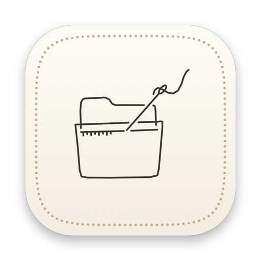
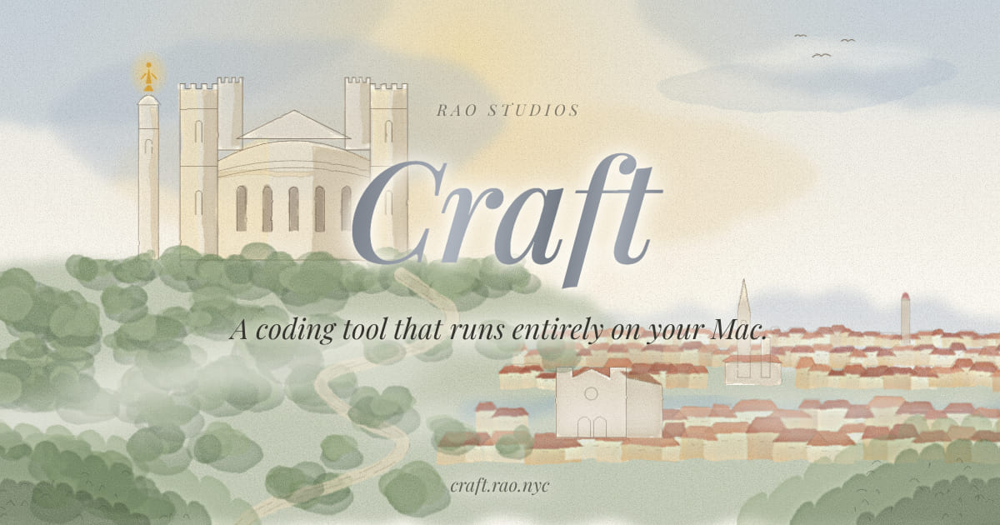

[![Crafted, by Rao Studios: drop a folder, download an agent for Craft. On a warm black plate, the title Crafted in silver italic. Below it, two folders sit at the left: a designer's work, with paint swatches and a page peeking out, on a brass thread, and an engineer's project, with lines of code peeking out, on a blue thread. Both threads run right into the eye of one steel needle, two models on this Mac, and the needle stitches them onto a cream tile ringed with French knots, an agent for the Craft Agent Store. The legend reads: vision, Ministral 3 8B; coder, Qwen3-Coder-Next; designer, style agent; engineer, ported agent.](Docs/README_Assets/hero.png)](Docs/README_Assets/hero.png)

# Crafted



Drop a folder, and download an agent for Craft.

Crafted is a macOS app in the Rao Studios line, a companion to [Craft](https://craft.rao.nyc). It does one thing. You drag a folder in, and two on-device models prepare a Craft agent from it: a Swift package on Granite's agent standard, with its listing and icon, zipped as a repository ready to push for the Craft Agent Store. Nothing leaves your Mac until you push it.

<br clear="left">

## What your Mac needs

Crafted runs both of its models on your Mac, with nothing sent anywhere, so it asks a lot of the machine. Today it needs:

| | | |
| --- | --- | --- |
| **Chip** | Apple silicon | MLX runs the models on the Mac's own GPU |
| **Memory** | 48 GB of unified memory | The coder alone holds 27.5 GB while it works |
| **Disk** | About 40 GB free | 37.9 GB for the two models, shared with Craft if you have it |
| **System** | macOS 27 | |
| **Tools** | Xcode, or the Command Line Tools, with Swift 6.4 | To build, test and install the agent it makes. An engineer's agent needs them; a designer's agent can be made without them, marked "not built here" |

```
 What a run holds at its peak, against a Mac's memory (one column = 1 GB)

 0       8       16      24      32      40      48 GB
 ├───────┼───────┼───────┼───────┼───────┼───────┤
 ███████████████████████████▌                             the coder's weights, 27.5 GB
                             ▓                            its context, under 1 GB at 24k tokens
                              ▒▒▒                         a swift build beside it, about 3 GB
                                 ░░░░░░░░                 macOS and your other apps, about 8 GB
 ███████████████████████████▌▓▒▒▒░░░░░░░░                 about 40 GB: a 48 GB Mac has ~8 to spare
```

Only one model is in memory at a time. A designer's run does all its looking with the 10.4 GB vision model first, then lets it go before the coder loads. The weights and the context figures are the models' own; the build and the system figures are typical, not measured.

### Bringing it to smaller Macs

Today's 48 GB floor is the price of the coder Crafted trusts most. Memory is the most expensive part of a Mac, so we are working to bring Crafted to smaller ones:

```
 Mac memory   the coder it runs

  16 GB   ░░░░░░░░░░░░░░░░   planned · Qwen2.5-Coder 7B, 4.3 GB, and a smaller vision model
  24 GB   ░░░░░░░░░░░░░░░░   planned · Qwen2.5-Coder 14B, 8.3 GB
  32 GB   ░░░░░░░░░░░░░░░░   planned · Qwen3-Coder 30B, 17.2 GB
  48 GB   ████████████████   today   · Qwen3-Coder-Next 48B, 27.5 GB, with little to spare
  64 GB+  ████████████████   today   · the same, with room for everything else you have open
```

- **Smaller coders.** Rao Studios already mirrors smaller coders for Craft, and Crafted's model catalog takes a new model as a single entry.
- **Retries guard quality.** A smaller model may need more attempts, because every unit it writes is compiled and tested before it counts. A run on a smaller Mac should take longer and may leave more out, but it will not ship a command that fails its checks.
- **Designers first.** We expect the designer's path to come to smaller Macs first: there the coder only writes the style document, which is a far smaller job than a port.

None of this is in 0.0.0. Until then, the onboarding tells you plainly when a Mac falls short.

## Craft, and why Crafted exists

<p align="center"><a href="https://craft.rao.nyc"></a></p>

[Craft](https://craft.rao.nyc) is a coding tool that runs entirely on your Mac. Its model calls on **agents** for work it cannot do alone: drawing an infographic, filtering a photo, building an app's design system. Anyone can make an agent and list it in the **Craft Agent Store**, where people find it and install it into Craft. An agent can be free, or priced per request in Credits. Its creator earns **90% of every call and every sale**; Rao keeps 10% and pays the card fees. Selling an agent with a price needs Rao Plus.

**Why Crafted exists.** Many designers and engineers already have the work that would make a good agent: a design system refined over years of pieces, or an old project whose rules still hold. Until now, turning that into an agent meant learning Swift, Granite and the agent standard. Crafted does that part for you. Drop the folder, and the work you have already done becomes an agent in the store, credited to you and paid for every time someone uses it. That is your style, or your logic, earning for you from the moment it is listed, as more and more work is done with A.I.

## Two kinds of folder

**A designer's work.** Drop a folder of your pieces: posters, brochures, PDFs, SVGs, fonts, a `tokens.css`. Crafted reads your design system in three passes:

1. Code measures what can be measured: the palette in OKLab weighted by area, type families and their licences, margins and marks.
2. The vision model looks at the pieces one at a time and names layout, hierarchy, type character and motifs. It refers to colours only by the letters of the measured palette, so it can never invent a hex.
3. The coder model reconciles both into one design system, `style.json`, where a measured fact always wins over a guess.

The agent you download is a fixed, pre-tested template carrying that design system. Anyone can then ask it for a brochure, a poster, a flyer, a social card or a slide in your style. It writes the words as blocks, its kit lays them out, and every piece credits you.

**An engineer's project.** Drop a project in any language. The coder model walks every file and writes a card for each one, citing every claim to the lines it came from. Code checks each card against the source before it counts. The cards are reduced to use cases (an entry, the rules it applies, the data, the effects, the author's intent). From those, Crafted offers three agents the project could become:

- **Whole:** the product as one agent.
- **Core:** its strongest capability, done deeply.
- **Material:** what it knows, prepared for Craft's Canvas or for other agents.

You pick one, or steer with your own words. Crafted then ports it to Swift inside a fixed skeleton, one small unit at a time. Each unit is compiled and tested against vectors taken from the project's own tests, and is repaired until it passes. A unit that cannot pass is set aside and you choose what happens to it: nothing ships stubbed.

<p align="center"></p>

Both paths follow the rule PlateAgent taught Craft: **the model says what it means, and fixed code places it.** A model writes meaning into small typed slots: a style document, a file card, a command spec, one Swift function behind a contract the compiler checks. The wiring, the layout, the conformance to `granite-agent/1` and every check are fixed code. Accuracy matters more than speed here. A run can take a long time, and every answer a model gives is kept on disk, so a cancelled or interrupted run resumes where it stopped and asks nothing twice.

The plates are rebuilt by `Docs/README_Assets/src/build.sh`.

## How long a run takes

Crafted is built for accuracy, not speed: it reads everything, checks every claim against the source, and compiles and tests every unit it writes. On-device models are slower than a data centre's, so expect a run to be measured in minutes for a designer's folder and in hours for a large project. You can leave it running: it holds the Mac awake while it works, and anything it has already asked a model is kept on disk.

| What you drop | The models' time | Builds, tests, install | All together, on an M4 Max |
| --- | --- | --- | --- |
| A designer's folder, 24 pieces looked at | ~12 min | 1–5 min | **~15–20 min** |
| A small project, ~10 files | ~20 min | 2–5 min | **~25–40 min** |
| A medium project, ~100 files, ~10,000 lines | ~1.3 h | 10–15 min | **~1.5–2.5 h** |
| A large project, ~500 files | ~4–5 h | ~30 min | **~5–7 h**, best left overnight |

**Where these numbers come from:**

- **Measured.** The coder (Qwen3-Coder-Next 48B, 4-bit) decodes at 86 tokens a second on a short prompt, and at about 34 with 36,000 tokens of context. In a measured 80-minute Craft run, reading prompts took half the time. These are on an M4 Max with 128 GB.
- **Measured in this release.** The parts that need no model, with warm caches: building, testing and installing the agent, and calling each of its commands. They took about a minute. A first build and install of a new package took about two and a half minutes.
- **Estimated.** The vision model's pace (about 20 seconds a piece), and how many tokens each stage asks for.

These are estimates until the first runs on the real models; we will replace them with measured times. Another chip will differ, mostly with its memory bandwidth. Memory beyond what a run needs does not make it faster.

Where the time goes, and what is in memory while it does:

```
 GB   Designer · a folder, 24 pieces looked at · about 15–20 min
 48 ┤  · · · · · · · · · · · · · · · · · · · · · · · · · · · ·   48 GB, the floor today
 40 ┤
 32 ┤                                          ▒▒▒▒▒▒▒▒▒▒▒▒▒▒    ▒ a swift build beside it
 24 ┤                                  ▓▓▓▓▓▓▓▓▓▓▓▓▓▓▓▓▓▓▓▓▓▓    ▓ the coder, 27.5 GB
 16 ┤                                  ▓▓▓▓▓▓▓▓▓▓▓▓▓▓▓▓▓▓▓▓▓▓
  8 ┤     ░░░░░░░░░░░░░░░░░░░░░░░░░░░  ▓▓▓▓▓▓▓▓▓▓▓▓▓▓▓▓▓▓▓▓▓▓    ░ the vision model, 10.4 GB
  0 ┼──┴──┴──────────────────────────┴──┴──────┴─────────────┴─▶
       0  1                          10 11     13.5          18 min
          measure, then look at one     write  build, test,
          piece at a time, ~20 s each   the    install, draw
                                        style  the proofs
```

```
 GB   Engineer · a small project, about 10 files · about 25–40 min
 48 ┤  · · · · · · · · · · · · · · · · · · · · · · · · · · · · ·   48 GB, the floor today
 40 ┤
 32 ┤                                    ▒ ▒ ▒ ▒ ▒ ▒▒ ▒ ▒▒▒▒▒▒▒    ▒ a swift build at each try
 24 ┤   ▓▓▓▓▓▓▓▓▓▓▓▓▓▓▓▓▓▓▓▓▓▓▓▓▓▓▓▓▓▓▓▓▓▓▓▓▓▓▓▓▓▓▓▓▓▓▓▓▓▓▓▓▓▓▓    ▓ the coder, 27.5 GB
 16 ┤   ▓▓▓▓▓▓▓▓▓▓▓▓▓▓▓▓▓▓▓▓▓▓▓▓▓▓▓▓▓▓▓▓▓▓▓▓▓▓▓▓▓▓▓▓▓▓▓▓▓▓▓▓▓▓▓
  8 ┤   ▓▓▓▓▓▓▓▓▓▓▓▓▓▓▓▓▓▓▓▓▓▓▓▓▓▓▓▓▓▓▓▓▓▓▓▓▓▓▓▓▓▓▓▓▓▓▓▓▓▓▓▓▓▓▓
  0 ┼──┴───────────────┴───────┴───────┴────────────────┴──────┴─▶
       0               9       14      18               28     32 min
       load, then      use     three   plan, then port: tests,
       walk: a card    cases   agents, write · build ·  install,
       per file                choose  test, a unit     calls
                                       at a time
```

## The models

| | Model | Size | What it does |
| --- | --- | --- | --- |
| Vision | [`rao-studios/Ministral-3-8B-Instruct-2512-mlx-8bit`](https://huggingface.co/rao-studios/Ministral-3-8B-Instruct-2512-mlx-8bit) | 10.4 GB | Looks at a designer's pieces, one picture per turn |
| Coder | [`rao-studios/Qwen3-Coder-Next-REAP-48B-A3B-mlx-4bit`](https://huggingface.co/rao-studios/Qwen3-Coder-Next-REAP-48B-A3B-mlx-4bit) | 27.5 GB | Walks a project, offers three agents, writes the port |

The onboarding downloads both at pinned revisions. They are kept in the model home every Rao app shares, `~/.rao/models` (`AII_HOME` moves it), so a model Craft already downloaded is found and never fetched twice. Only one model is in memory at a time: a run does all its looking first, then all its coding. They run in-process on MLX through [Frigate](https://github.com/rao-studios/Frigate).

## What you download

The archive is a repository named for your agent, in the shape the Craft Agent Store lists:

```
InvoiceTotalsAgent/
  Package.swift  Package.resolved      a library product named for the package, on Granite
  Sources/InvoiceTotalsCore/           the ported guts (engineer) — or InvoiceTotalsKit, the style kit (designer)
  Sources/InvoiceTotalsAgent/          the GraniteAgentPackage, its two-line roster record, the router and emitters
  Tests/                               conformance, and the vectors the port was held to
  Assets/listing.json  Assets/icon.png the store listing and icon you edited in Crafted
  README.md  LICENSE  NOTICE  PROVENANCE.md
```

Push it to GitHub and list it in the store, or install it into Craft directly with `craft agents add <folder>`. Before Crafted offers a download, the package passes these gates:

- **Store rules:** a port of the store's own static validator.
- **Secrets:** a scan for secrets and private paths.
- **Build:** a `swift build`.
- **Install:** where a toolchain is present, a real install through Granite's installer, with one call over the wire for each command.

## Using it

- **Onboarding.** It downloads the two models (or finds them), then asks whether you are a designer or an engineer. You can change that later in Settings › General.
- **Home.** Drop a folder on the painting, or on the Dock icon. Below the painting is the library: every generation you have made, kept in Crafted's own folder (`~/Library/Application Support/nyc.rao.crafted`).
- **Generating.** The painting washes in as the run goes. Beside it are the stage, the file being read or written, the counts and the model's speed. Questions only you can answer appear as cards: which fonts may ship, a unit that would not port.
- **Listing & icon.** Open the form at any time during a run, and it is the page you land on when the run finishes. Edit the name, word, tagline, category, keywords, licence and credit, and add an icon. The store's rules are checked as you type. Your edits are never overwritten by the run.
- **Download.** The package is assembled again from the run with your listing and icon, checked, and zipped. Reopen any generation from the library to edit it, update it from a changed folder (unchanged files are not read again), and download again.

## Build and run

The requirements are in [What your Mac needs](#what-your-mac-needs). Then:

```sh
swift build --build-system native            # every target (the native build system: see Scripts/dev/dev.sh)
./Scripts/dev/test.sh                         # the tests that need no model
./Scripts/dev/dev.sh                          # build, install MLX's metallib, sign, run
./Scripts/build/make-app.sh                   # build/Crafted.app, icon compiled, signed
./Scripts/release/release.sh                  # a notarized .pkg (needs Developer ID identities)
```

`crafted-check` runs the forge from the terminal:

```sh
swift build --build-system native --product crafted-check
.build/debug/crafted-check forge --role engineer --models scripted --choose 1 --zip out.zip Fixtures/projects/py-unit-converter
.build/debug/crafted-check forge --role designer --models scripted --zip out.zip Fixtures/design/swiss-mono
.build/debug/crafted-check validate <package>     # the store and ship gates on any agent package
```

`--models scripted` replaces both models with canned answers, one script per folder in `Fixtures/scripts` (`CRAFTED_SCRIPTS` moves them). It runs the real pipeline, templates, builds and zip without loading a model. The fixtures are small, real inputs:

- `py-unit-converter`: a Python CLI with tests.
- `js-invoice-calculator`: JavaScript with no tests and a rates table.
- `swift-textstats`: a Swift library, so code is lifted rather than ported.
- `swiss-mono` and `velvet-night`: two design folders, one light and one dark. velvet-night names a typeface it does not include, so the agent must stand one in, and carries a client's logo that must never ship.

Each project also carries a fake key and a `.env`, so the run proves it withholds them.

The app takes the same switch. This drives the real services headlessly through a run, a listing edit, a new icon and a download:

```sh
CRAFTED_MODELS=scripted CRAFTED_HOME="$(mktemp -d)" ./Scripts/dev/dev.sh        # the app, no model loaded
CRAFTED_SELFTEST=Fixtures/design/swiss-mono CRAFTED_MODELS=scripted CRAFTED_HOME="$(mktemp -d)" ./Scripts/dev/dev.sh
```

## Layout

| | |
| --- | --- |
| `Sources/CraftedCore` | Roles, the two models, naming, the listing and the store's rules, generations on disk, export |
| `Sources/CraftedForge` | The forge: folder in, package out. The designer and engineer pipelines, the ledger, structured asks, assembly, the gates. No UI, no MLX |
| `Sources/CraftedMLX` | The model home, downloads, and the one-resident MLX runtime |
| `Sources/CraftedToolchain` | `swift build` and `swift test`, and Granite's installer for the install gate |
| `Sources/CraftedRuntime` | The Granite services: models, preferences, the library, the forge |
| `Sources/CraftedApp` | The Mac app: a Granite component per page, a service per subsystem, one root holding the relays |
| `Templates/` | The two agent templates, each a Swift package that builds and tests on its own |
| `Fixtures/` | Design folders and projects to drop, and the scripted answers that stand in for the models |
| `Shaders/`, `Design/`, `Scripts/art` | The watercolour wash, the icon glyphs, and the scripts that render them |

## Status

This is 0.0.0, the first release. The whole flow runs end to end and has been checked from a dropped folder to a built, zipped package, for both roles. In those runs the scripted models stood in for the real ones. Runs on the two real models, and tuning their prompts and budgets, come next. Pushing to GitHub straight from the app is planned.

## Support

Questions, problems, or an agent you made with Crafted that you would like us to see: email **[ritesh@rao.nyc](mailto:ritesh@rao.nyc)**. Issues and pull requests are welcome here too.

## Licence

Crafted is under the GNU General Public License v3.0 (`LICENSE`). The agent templates in `Templates/` are under the MIT licence, so the agents you make with Crafted are yours to licence as you choose; the listing form sets it.
